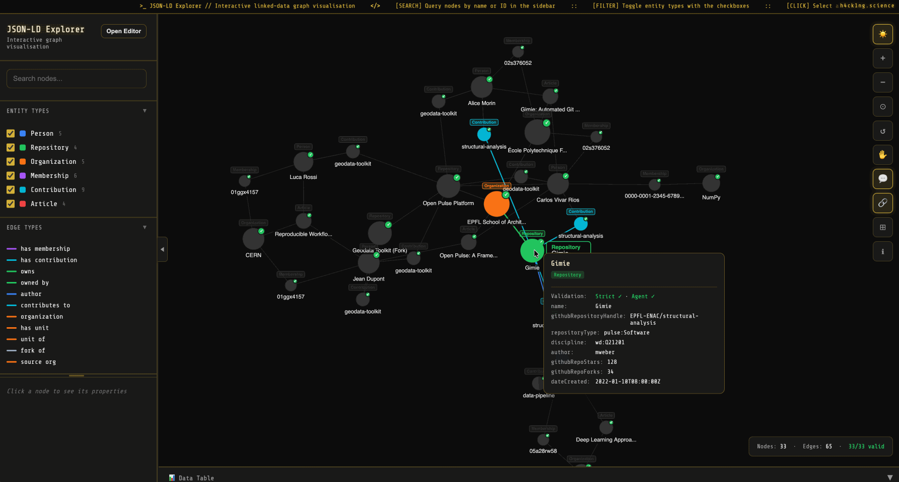

# JSON-LD Explorer

Browser-based editor for [JSON-LD](https://json-ld.org/) graphs and ontologies: design an ontology by **reusing existing vocabularies**, edit instances, validate them, and publish the result as a queryable [rete](https://github.com/caviri/rete) file. Built with **Sigma.js**, **Graphology**, **CodeMirror** and the **rete** WebAssembly engine. No server, no build step: it runs as a static site (GitHub Pages works).



---

## ✨ Features

| Area | What you get |
|---|---|
| **Any JSON-LD** | `@context` prefixes and aliases, `@vocab`, `@base`, `@type` arrays, nested nodes, `@graph`, `@list`, `@reverse`, value objects. Types and colours come from the document; `js/config.js` styling is optional. |
| **Open / save** | New from templates (ontology starter, SKOS scheme, empty dataset, sample). Open JSON-LD, Turtle, N-Triples, N-Quads, TriG or `.rete` from a file, a URL, drag and drop, or `?src=URL`. Work is autosaved in the browser. |
| **Term Finder** (Ctrl+K) | Search 15 bundled vocabularies (schema.org, DCTerms, DC, FOAF, SKOS, PROV-O, ORG, DCAT 3, OWL-Time, SHACL, VANN, OWL, RDFS, RDF, XSD), any vocabulary you load, the terms of your document, plus **OLS** (EMBL-EBI, 270+ ontologies) and **Wikidata**. Insert a term, add it to the selected node, use it as a type, subclass it, or declare it. |
| **Create by reuse** | Forms for classes, object/datatype properties, instances and an ontology header. While you type a name, existing terms with that name are suggested ("Research dataset" → `schema:Dataset`, `dcat:Dataset`). New instances are pre-filled with the properties declared for their class. |
| **Vocabulary library** | Load SOSA, SSN, vCard, LOCN, ADMS, DQV, ODRL, LDP, ActivityStreams, BIBO, QUDT units… or your own ontology (URL or file, including `.rete`). A reuse report shows how much of the document comes from established vocabularies. |
| **Source editor** | JSON-LD **or Turtle** view of the same document, syntax colouring (keywords, IRIs, prefixed names, bracket depth), vocabulary autocomplete (Ctrl+Space; missing prefixes are added), live apply, code folding, problem markers, minimap. Resize by dragging its edge; ⇔ toggles half screen. Every edit from the UI is undoable with Ctrl+Z. |
| **Views** | Network view (force, circular, radial, grid layouts); **schema view** 🧬 (classes, subclassing, domain → range, links observed in the data, SHACL shapes on their target classes); **box diagram** ▭ (each node as a card with its values, joined by right-angled connectors; a UML-like class diagram in the schema view). External IRIs 🌐 and `rdf:type` links Ⓣ are optional. |
| **Problems** | IRIs that RDF tools silently drop, keys that do not map to an IRI, undefined prefixes, misspelled vocabulary terms ("did you mean `schema:name`?"), strings that should be links, undeclared terms, missing labels/definitions/domains/ranges, with one-click fixes. **Verify with rete** compares the document with its real RDF conversion. |
| **SPARQL** | SPARQL 1.1 over the document in the browser (optional OWL 2 QL reasoning). CONSTRUCT results can be opened as a new document, e.g. to extract the ontology module. |
| **SHACL** | Generate starter shapes from the ontology (domain/range), the data, or both; load shapes from `.ttl`; keep shapes in the document next to the ontology and instances; validate; see ✓/✗ badges on the graph. |
| **Export** | JSON-LD, the ontology module alone (for others to reuse), Turtle, N-Triples, N-Quads, and **`.rete` with a Dataset Card** (title, licence, creators, keywords). |

## 🔗 rete compatibility

The editor uses [`rete-graph`](https://www.npmjs.com/package/rete-graph) (pinned in `js/config.js`, loaded from jsDelivr **only when a rete feature is used**, ~8.5 MB). Nothing is uploaded: the engine runs in the page.

- **Export → .rete file…** builds a `.rete` with an embedded Dataset Card. Host it on any static server with HTTP range requests and query it with `rete query`, Python, JavaScript or the [rete playground](https://caviri.github.io/rete/docs/playground.html).
- **Open** accepts `.rete` files (local or URL) and converts them to JSON-LD (up to 20,000 triples; configurable).
- Turtle / N-Triples / N-Quads import and export, the Turtle source view, SPARQL, SHACL, live vocabulary loading and *Verify with rete* all use the same engine, so what you see is what `rete build` will store.

## 🚀 Quick start

```bash
python3 -m http.server 8000     # any static file server
# open http://localhost:8000
# or http://localhost:8000/?src=https://example.org/data.jsonld
```

Push to GitHub and enable **GitHub Pages** to publish it — no build step.

### Keyboard

| Keys | Action |
|---|---|
| Ctrl+K | Open the Term Finder |
| Ctrl+Space | Suggest terms in the editor |
| Ctrl+Enter | Apply the editor (also runs SPARQL / SHACL in their tabs) |
| Ctrl+S | Download the source (JSON-LD or Turtle) |
| Shift+Alt+F | Format the JSON |
| Ctrl+Z | Undo, including edits made from the workbench |

## 📁 Project structure

```
├── index.html               # Page shell, CDN tags
├── css/
│   ├── styles.css           # Base layout and themes
│   └── workbench.css        # Workbench, tools, diagram, editor colours, menus
├── js/
│   ├── config.js            # Optional styling, prefixes, vocabulary catalog, rete pin
│   ├── jsonld.js            # Small JSON-LD reader: contexts, IRIs, model
│   ├── graph.js             # Model → network / schema view data
│   ├── layouts.js           # Force, circular, radial, grid
│   ├── panels.js            # Resizable side panels
│   ├── editor.js            # CodeMirror: JSON-LD/Turtle, colours, autocomplete
│   ├── ui.js                # Sidebar, details, tables, tool tabs
│   ├── vocab.js             # Vocabulary library and term search
│   ├── rete.js              # rete engine bridge (build, import, export, SPARQL, SHACL)
│   ├── lint.js              # Problems
│   ├── ontology.js          # Ontology workbench (Find, Create, Library, @context)
│   ├── tools.js             # Problems, SPARQL and SHACL tabs
│   ├── io.js                # New / Open / Export, .rete dialog
│   ├── diagram.js           # Box diagram view
│   └── app.js               # Wiring and document state
├── data/
│   ├── sample.jsonld.json   # Default example (Open Pulse)
│   ├── validation_results.json  # Optional legacy validation overlay
│   └── vocabularies/index.json  # Bundled term index (generated)
└── tools/build_vocab_index.py   # Regenerates the term index
```

### Updating the bundled vocabularies

```bash
pip install rdflib
python tools/build_vocab_index.py
```

Edit `VOCABULARIES` in that script to add or remove a vocabulary. Vocabularies that only need to be available on demand go in `VOCAB_CATALOG` in `js/config.js` instead.

## ⚠ Known limitations

- The JSON-LD reader in `js/jsonld.js` is for visualising and editing. Remote `@context` URLs other than schema.org are fetched if they allow CORS; the rete engine reads inline contexts only.
- Editing in the Turtle view regenerates the JSON-LD from the triples (prefixes are kept; term aliases and key order are not).
- The box diagram shows at most 600 nodes; hide types in the sidebar for larger graphs.
- `visualize_jsonld.py` is the original generator of a standalone HTML page and is not used by the app.

## 🛠 Dependencies (CDN)

- [Graphology](https://graphology.github.io/) 0.25.4 and [Sigma.js](https://www.sigmajs.org/) 2.4.0 (jsDelivr)
- [CodeMirror](https://codemirror.net/5/) 5.65.16 and add-ons (cdnjs)
- [rete-graph](https://www.npmjs.com/package/rete-graph) 0.7.8 (jsDelivr, loaded on demand)

## 📄 License

MIT
